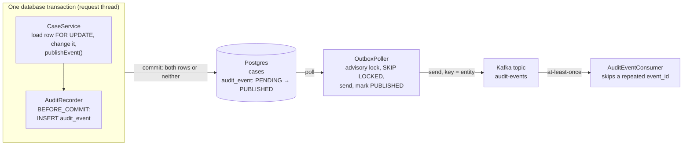

# Audit events in Spring Boot: architecture options

**Decision:** save the audit row in the same database transaction as the business change, and have
a scheduled poller publish it to Kafka. This is the transactional outbox pattern. Every other option
either loses events or audits changes that never happened.

The code in this sample implements it. The README's "Guarantees" table maps each claim below to the
test that proves it.

## Context and problem

The application is a standard Spring Boot service: Spring MVC, Spring Data JPA, Postgres, blocking
I/O. Every update the backend makes must produce two things:

- **A durable audit record** in an `audit_event` table: who changed what, when, and the state before
  and after.
- **A message on Kafka**, so other services (search, notifications, analytics, a SIEM) can react.

Requirements:

- An audit record exists if and only if the business change committed.
- No event is lost when the application or Kafka crashes, restarts or is unavailable.
- Events for one entity reach consumers in the order they were committed.
- Requests still succeed while Kafka is down.

Non-goals: exactly-once delivery end to end (at-least-once plus consumer deduplication is enough),
and auditing reads.

## Decision drivers

| Driver | What it means here |
|---|---|
| Atomicity | The audit row and the business change commit or roll back together |
| No lost events | A crash at any point never silently drops an event |
| No phantom events | Nothing is published for a transaction that rolled back |
| Ordering | Events for one entity are consumed in the order they were committed |
| Availability | A Kafka outage does not fail user requests |
| Actor capture | The audit record names the user who made the change |
| Business meaning | The record says what happened (`CASE_CLOSED`), not only which columns changed |
| Operational cost | Extra infrastructure, code to own, and things to monitor |
| Latency | Time from commit to the event being on Kafka |

## Options considered

Options A to F differ in how an event gets to Kafka. Option G covers how changes are detected, and it
combines with any of A to F.

### A. Dual write: save, then send to Kafka in the same method

```java
@Transactional
public void close(UUID id) {
    caseRepo.save(c.close());
    auditRepo.save(audit);
    kafkaTemplate.send("audit-events", key, payload);   // outside the DB transaction's guarantees
}
```

- **Pros:** trivial to write.
- **Cons:** if the send succeeds and the transaction then rolls back, Kafka holds an event for a
  change that never happened. If the app crashes after the commit, or Kafka is down, the event is
  lost. A Kafka outage also slows or fails every write.

### B. Publish from an `AFTER_COMMIT` listener

The service publishes a Spring event, and `@TransactionalEventListener(phase = AFTER_COMMIT)` sends it
to Kafka.

- **Pros:** no phantom events, and the code is still small.
- **Cons:** the event lives only in memory between the commit and the send. A crash, a deploy or a
  Kafka outage in that window loses it, and nothing records that it is missing.

### C. Send to Kafka first and let a consumer write the audit table

- **Pros:** the write path stays fast, and the audit store is decoupled.
- **Cons:** this is still a dual write, now between Kafka and the database. The audit record depends
  on the broker, and it can disagree with the business data.

### D. Transactional outbox with a polling publisher (chosen)

The service writes the business change and an `audit_event` row (status `PENDING`) in one
transaction. A `@Scheduled` poller takes a Postgres advisory lock, locks due rows with
`FOR UPDATE SKIP LOCKED`, sends them to Kafka, and marks them `PUBLISHED`.

- **Pros:** atomic and lossless. It survives Kafka outages of any length and crashes. It runs safely
  on several instances, because the advisory lock lets one poll at a time. It adds no infrastructure.
  The audit table is both the record and the outbox.
- **Cons:** delivery is at-least-once, so consumers must deduplicate. You own the poller code
  (about 200 lines). Latency is the poll interval, about 1 s. Strict per-entity order also needs
  writers to lock the business row first.

### E. Transactional outbox with Spring Modulith event externalization

`spring-modulith-events-jpa` stores published application events in an `event_publication` table
inside the transaction. `spring-modulith-events-kafka` with `@Externalized` sends them to Kafka after
commit and marks them complete. Unfinished ones are retried, including on restart.

- **Pros:** the same atomicity as D, with almost no code of your own.
- **Cons:** less control over backoff, ordering and the failed state. It is a framework table separate
  from your audit table, so you still write `audit_event` yourself. It adds a dependency on Modulith's
  release cadence.
- Not verified in this sample: the Modulith behaviour above comes from memory and was not run or
  checked against Modulith's documentation.

### F. Change data capture (Debezium) from the Postgres WAL

Write `audit_event` (or an outbox table) in the transaction as in D. Debezium reads the write-ahead
log and publishes to Kafka, for example with its Outbox Event Router.

- **Pros:** no polling, low latency, no publishing code in the app, high throughput.
- **Cons:** you have to run Kafka Connect and Debezium, manage replication slots and WAL retention,
  and monitor all of it. That is real operational weight for an audit trail.

### G. How changes are detected (combines with A to F)

| Technique | Captures | Limits |
|---|---|---|
| Explicit domain events in the service layer (chosen) | Business meaning, actor, before and after | Each write path must publish one. Bulk or native SQL and other applications are not audited |
| Hibernate Envers (`@Audited`) | Full row-version history automatically | No business meaning, and it does not publish to Kafka |
| JPA `@EntityListeners` or Hibernate event listeners | Every entity write through JPA | Misses bulk JPQL and native SQL updates |
| Database triggers | Every write, including manual SQL | No actor unless set in a session variable. The logic lives outside the code |
| Spring Data `@CreatedBy` / `@LastModifiedBy` | Last editor and timestamp only | No history |

## Comparison

Only D, E and F meet both correctness requirements: atomic and lossless. Among those, D has the lowest
operating cost with full control. The latency and ops-cost cells, and E's "Mostly" for ordering, are
judgement rather than measurement.

| Option | Atomic | No lost events | No phantom events | Survives Kafka outage | Per-entity order | Latency | Ops cost |
|---|---|---|---|---|---|---|---|
| A. Dual write | No | No | No | No | Usually | Immediate | None |
| B. AFTER_COMMIT listener | No | No | Yes | No | Usually | Immediate | None |
| C. Consumer writes audit | No | No | No | No | Yes | Seconds | Low |
| **D. Outbox + poller** | **Yes** | **Yes** | **Yes** | **Yes** | **Yes, with a row lock** | **About 1 s** | **Low: own about 200 lines** |
| E. Outbox + Modulith | Yes | Yes | Yes | Yes | Mostly | Immediate after commit, retries later | Low: framework |
| F. Outbox + Debezium | Yes | Yes | Yes | Yes | Yes | Milliseconds | High: Connect, slots, WAL |

## The chosen design



If the poller or Kafka is down, rows wait in `audit_event`. Nothing is lost and requests still
succeed.

Why D:

- It is the only option with no extra infrastructure that meets every correctness driver.
- The audit table is the source of truth. Kafka distributes events but is not the record.
- A Postgres advisory lock (`pg_try_advisory_xact_lock`) lets exactly one poller run at a time across
  all instances, with no leader election or ShedLock.
- Backoff, the `FAILED` state and per-entity ordering are explicit code you can test.

When to choose another option:

- **E (Modulith)** if the team already uses Spring Modulith and accepts its defaults for retry and
  ordering.
- **F (Debezium)** if volume reaches thousands of events per second (a judgement threshold, not a
  benchmark), latency must be well under a second, or Kafka Connect is already run as a platform.

### Design points the review changed

An independent review of the first version found four problems. Each is now fixed and tested:

1. **Insert order is not commit order.** The audit `INSERT` runs at `BEFORE_COMMIT`, before Hibernate
   flushes the business `UPDATE`. Two writers to one entity could get audit ids in one order and commit
   in the other. Services now load the row with `SELECT ... FOR UPDATE`
   (`CaseRepository.findByIdForUpdate`), so the second writer waits before it inserts anything.
2. **An outage made every row `FAILED`.** With 10 attempts and backoff capped at 5 minutes, an outage
   of about 14 minutes exhausted every row. Retriable Kafka errors and the poller's own send timeout
   now stop the batch and back off without counting towards `FAILED`. Only record-specific errors,
   such as a record that is too large, count.
3. **The concurrency test could not fail.** It is replaced by two tests that hold a lock in another
   transaction: one proves a second poller skips the pass, the other proves the poller passes over a
   locked row instead of waiting. `publishBatch()` now returns a `BatchResult`, so "another instance
   holds the lock" is no longer the same answer as "nothing was due".
4. **The transaction timeout did not do what the code claimed.** With JPA, Spring applies a
   transaction timeout only as a timeout on queries, as `EntityManagerFactoryUtils` in spring-orm
   6.2.19 shows. It does not bound time spent waiting on Kafka or fail the commit. The setting and its
   startup check are removed. The batch bounds itself by stopping at the first broker failure.

## Failure modes

| What fails | What happens |
|---|---|
| Business transaction rolls back | Neither the change nor the audit row is saved, and nothing reaches Kafka |
| Kafka is down, for any length of time | Rows stay `PENDING`; each poll tries one send, then backs off. Requests still succeed |
| The broker rejects a record (for example, too large) | Retried with backoff, then `FAILED` after `max-attempts`. An alert fires |
| Crash after the Kafka send, before the commit | The row stays `PENDING` and is sent again. The consumer skips the duplicate by `event_id` |
| Several app instances | The advisory lock lets one poll at a time; the others skip that pass |
| Two requests change one entity at once | The second waits on the row lock, so audit order is commit order |
| One entity's event fails | Later events for that entity wait, which preserves order |
| The app shuts down mid-send | The row is left as it was; no retry is used up |
| Consumer crashes mid-processing | The offset is not committed, the record is redelivered, and the dedup marker makes the retry safe |
| The consumer cannot process a record | Retried twice, then logged and skipped. The audit row and the Kafka record still exist; add a dead-letter topic |

## Operations

- **Alert on** the age of the oldest `PENDING` row, and on any `FAILED` row.
- **A `FAILED` row blocks** later events of its entity on purpose. Fix the cause, then set the row back
  to `PENDING` with `attempts = 0` and `next_attempt_at = now()`.
- **Throughput.** One poller sends one record at a time. For more, send a batch asynchronously and wait
  on all the futures, or move to option F.
- **Retention.** `PUBLISHED` rows are the audit trail. Archive or partition `audit_event` by your
  retention policy, and prune `processed_event` past the topic's retention.

## Open questions

- Expected event volume at peak. Above roughly 1,000 events per second, revisit option F. That figure
  is a judgement, not a measurement: load-test the poller before relying on it.
- Retention period for `audit_event`, and whether audit rows must be immutable. If so, use a separate
  outbox table and keep `audit_event` insert-only.
- Whether a full row history (Envers) needs to sit alongside the business events.
- Which fields in the before/after snapshots are personal data that must be masked or excluded.
- Topic partitions and replication factor for `audit-events` in production.
- Who owns the `FAILED` alert, and the runbook for replaying failed rows.

## How this was verified

- `./mvnw verify`: 26 tests, 0 failures, against Postgres 16 and Kafka 3.8 in Testcontainers.
- Seven guards were each shown to make their test fail when the logic was removed: the business row
  lock, the advisory lock, `SKIP LOCKED`, broker-outage handling, the per-entity `NOT EXISTS` predicate,
  the in-batch blocked-key check, and consumer deduplication.
- The app was run against `compose.yaml` and exercised with `curl`: two changes, both `PUBLISHED`,
  actor recorded, consumer count 2, and 401 without credentials.
- Library behaviour was checked in the source jars this build resolves (spring-tx and spring-orm
  6.2.19, kafka-clients 3.9.2): `fallbackExecution` defaults to `false`; `delivery.timeout.ms` must be
  at least `request.timeout.ms` + `linger.ms`, and `linger.ms` defaults to 0; `max.block.ms` bounds
  `send()`'s wait for metadata; Kafka's `TimeoutException` is a `RetriableException`.
- Not verified: the Spring Modulith details in option E, and the Debezium details in option F.
